# Step-by-step guide for developers

How to list an app on TestSwap, where to get the SDK and how to add it to your code. Short reference without
screenshots: [For developers](developer.md), [SDK](sdk.md), [Rules and points](rules.md).

The screenshots below show the English interface of the site (switch with the UK/EN selector in the header).

## 1. Sign in

Open https://testswap.yednamo.com/en and press **“Sign in”** in the top right corner. Sign-in is via Google
(Yednamo ID): pick an account and you are back on the site. One account works for every Yednamo service.

## 2. Prepare the closed test in Play Console

This happens on Google’s side, before or after listing on TestSwap.

1. In [Play Console](https://play.google.com/console) open the app → **Testing → Closed testing** and create a
   track if there is none yet.
2. Create a Google Group for testers: https://groups.google.com → **Create group**. Under “Who can join the group”
   choose **“Anyone on the web can join”**; conversations can be hidden. Note the group address,
   `name@googlegroups.com`.
3. In Play Console: Closed testing → **Testers** tab → **Create list** → add the group address. Save. You do not
   need the “Join on the web” link from there: TestSwap builds it from the package name.
4. Upload a build to the closed testing track and publish the release. Wait for Google’s review (usually up to a
   few days).
5. If the app has Google sign-in, add the SHA-1 of the **Google Play app signing key** (Play Console → Protected
   with Play → App signing) to Google Cloud, otherwise sign-in will not work for testers. Details in
   [For developers](developer.md#1-prepare-the-closed-test-in-play-console).

## 3. List the app on TestSwap

Open **“My apps”** in the top menu and press **“List an app”**.

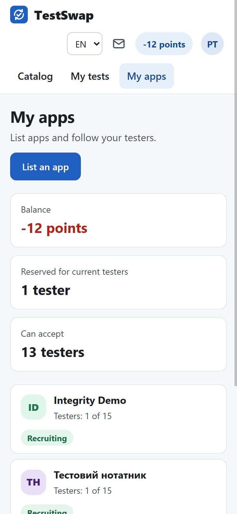

Fill in the form.

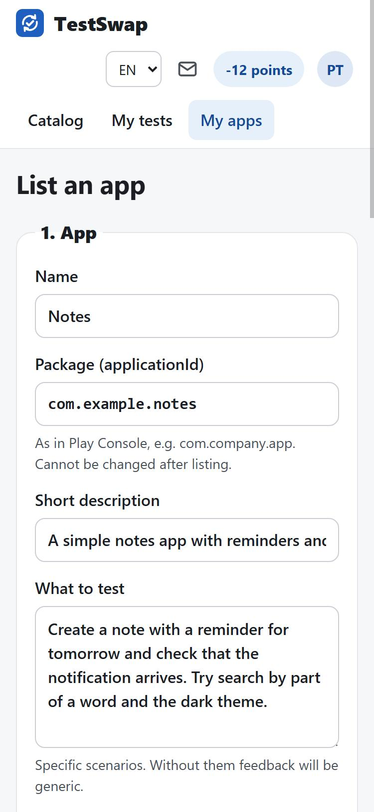

- **Name** — as on Google Play.
- **Package (applicationId)** — exactly as in Play Console, for example `com.company.app`. It cannot be changed
  after listing: tester links are built from it.
- **Short description** — one or two sentences for the catalog card.
- **What to test** — specific scenarios (“create a note with a reminder and check the notification”). Without
  this, feedback will be generic.
- **Category** and **minimum Android version** — as in Play Console. SDK mode needs Android 8+.

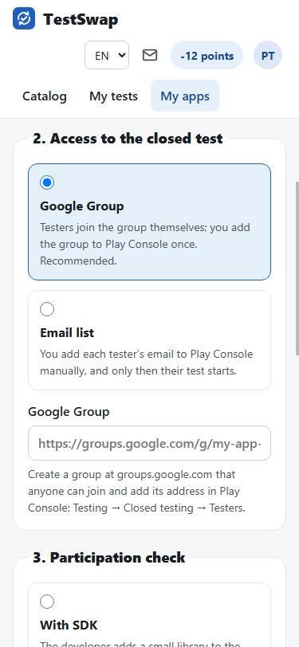

- **Access to the closed test**: choose **Google Group** and paste the group address or link from step 2. “Email
  list” means you add every tester’s email in Play Console by hand, and only then their test starts.
- **Participation check**: **With SDK** (the app confirms installs and days itself through Google Play
  Integrity, see section 5) or **Without SDK** (the tester checks in every day on the site). The mode can be
  changed only while nobody has joined yet.

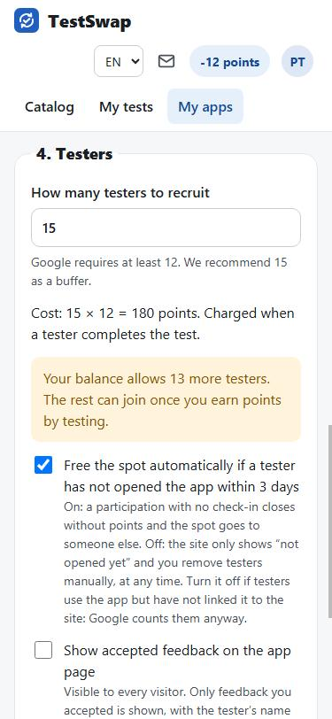

- **How many testers**: Google requires 12, we recommend 15 as a buffer. Each costs 12 points, charged only
  when the tester completes the test. You can list your first app with a zero balance: a debt down to −180
  points is allowed and is paid back by testing other apps.
- **Free the spot automatically** — a tester who has not opened the app within 3 days is removed on their own.
- Tick the confirmation about honest feedback review and press **“List”**.

## 4. The app dashboard

After listing, the dashboard opens. At the top three numbers: joined on the site, joined the group, opened the
app. Below, the **“Play Console setup”** panel with the group address to add to the tester list and the
**SDK app key** (`tsk_…`).

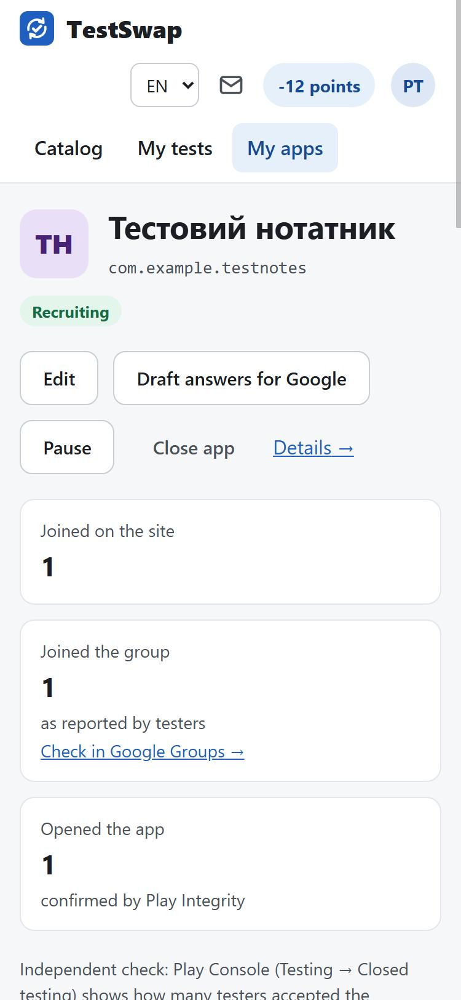

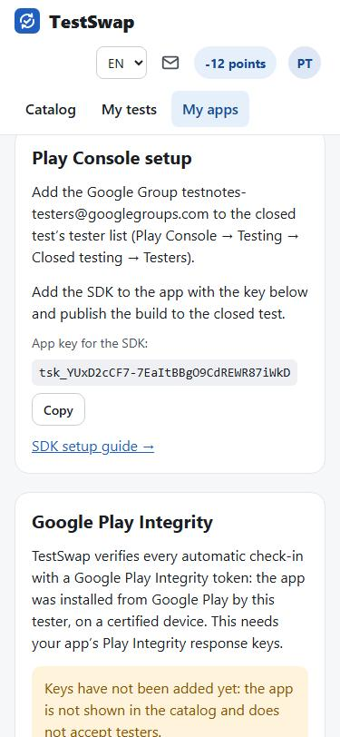

For SDK mode the **“Google Play Integrity”** panel follows. Until the keys are added, the app is not shown in
the catalog.

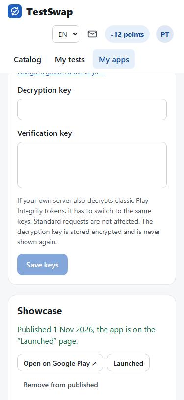

Where to get the keys:

1. Play Console → your app → **Play Integrity API** (in the left menu, under “Advanced settings” or “Release →
   App integrity”, depending on the console version). Make sure the API is enabled and a Google Cloud project
   is linked.
2. In **“Classic requests → Response encryption”** press **“Change”**, choose **“Manage and download my
   response encryption keys”**, then **“Download keys”**.
3. The downloaded file has two base64 lines: the **decryption key** and the **verification key**. Paste them into
   the matching fields on TestSwap and press **“Save keys”**.

The decryption key is stored encrypted and never shown again. More: [SDK](sdk.md#1-play-integrity-keys) and
[Google’s documentation](https://developer.android.com/google/play/integrity/classic).

## 5. SDK: where to get it and how to add it

The SDK is needed only for the **“With SDK”** mode. It is a small open-source library (MIT).

- Source and README: https://github.com/yednamo/testswap-sdk-android
- Ready builds are served by JitPack: https://jitpack.io/#yednamo/testswap-sdk-android (version list; “Get it”
  shows the Gradle lines).

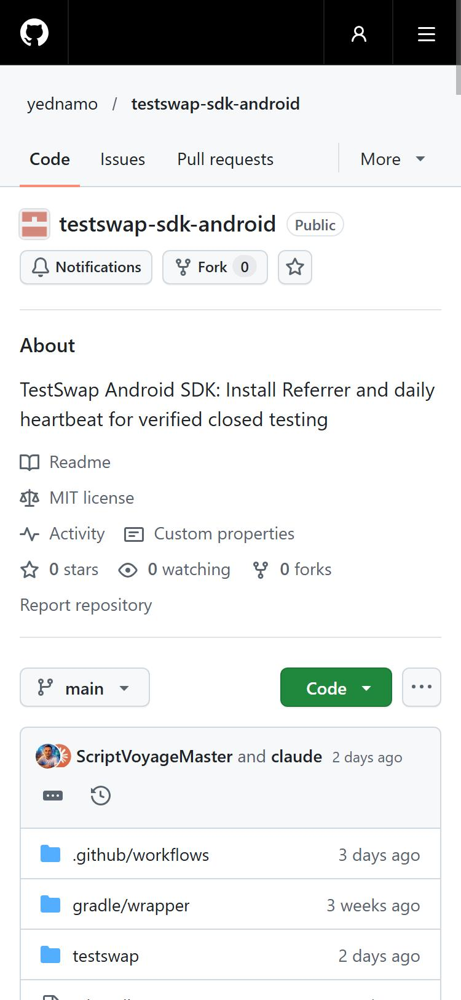

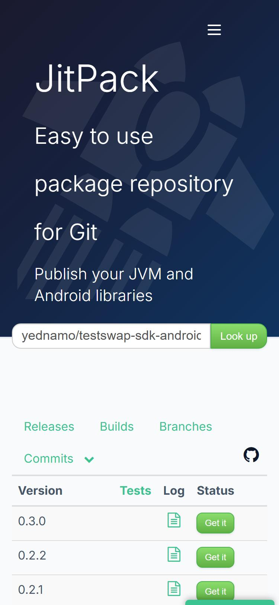

### Option 1 (recommended): Gradle dependency

`settings.gradle.kts` of the project — add the JitPack repository:

```kotlin
dependencyResolutionManagement {
    repositories {
        google()
        mavenCentral()
        maven { url = uri("https://jitpack.io") }
    }
}
```

`app/build.gradle.kts` — the dependency (current version on JitPack, now 0.3.0):

```kotlin
dependencies {
    implementation("com.github.yednamo:testswap-sdk-android:0.3.0")
}
```

### Option 2: download the AAR by hand

If your project cannot pull dependencies from JitPack, download the library file:

```
https://jitpack.io/com/github/yednamo/testswap-sdk-android/0.3.0/testswap-sdk-android-0.3.0.aar
```

Put it into `app/libs/` and reference it in `app/build.gradle.kts`:

```kotlin
dependencies {
    implementation(files("libs/testswap-sdk-android-0.3.0.aar"))
    implementation("com.android.installreferrer:installreferrer:2.2")
    implementation("com.google.android.play:integrity:1.6.0")
}
```

The two extra dependencies are needed because an AAR does not pull them in (via JitPack they come
automatically). The versions match `testswap/build.gradle.kts` in the SDK repository.

### The call in code

Create an `Application` class (or use the existing one) and call `TestSwap.init` with the app key from the
dashboard:

```kotlin
import android.app.Application
import com.yednamo.testswap.TestSwap

class App : Application() {
    override fun onCreate() {
        super.onCreate()
        TestSwap.init(this, "tsk_...") // key from the “Play Console setup” panel
    }
}
```

Java:

```java
public class App extends Application {
    @Override public void onCreate() {
        super.onCreate();
        TestSwap.init(this, "tsk_...");
    }
}
```

Reference the class in `AndroidManifest.xml` if it was not there yet:

```xml
<application android:name=".App" ...>
```

Nothing else to add: the `INTERNET` permission and the `LinkActivity` for the “I installed the app, link it”
link are declared by the library itself. Minimum Android version: 8.0 (API 26).

Build a release with the SDK, upload it to closed testing and publish. For diagnostics `TestSwap.setDebug(true)`
writes verbose messages to Logcat (tag `TestSwap`).

### Checking it works

1. The dashboard must say “Keys added”.
2. Join your own test from another Google account (on another phone), install the app via the personal link from
   the test page and open it.
3. In the dashboard the tester row shows “App opened …, confirmed by Play Integrity”, and the Integrity panel shows
   the time of the last successful check. If the check failed, the reason is shown there.

In the first release after going to production, remove the dependency and the `TestSwap.init` call.

## 6. During the test

Lower in the dashboard, the tester list: step (joined, in the group, opened the app), days 1–14, check-in source,
feedback.

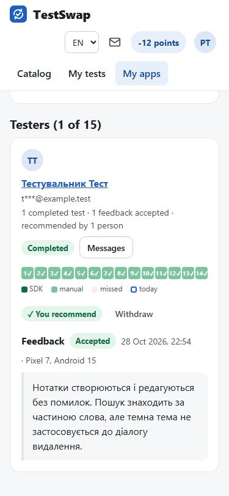

- **Feedback**: press “Accept” or “Reject” with an explanation. Without a decision within 3 days it is accepted
  automatically.
- **Messages**: the button next to a tester opens a private chat. All conversations are on the “Messages” page
  (the envelope in the header).
- **Remove from test**: if a tester did not install the app. One who has already checked in can be removed only
  until day 3.
- **Pause** stops recruiting, running tests continue. **Close app** — only after applying in Play Console: until
  then testers stay in the group, because Google counts only those in the test for the last 14 days.

## 7. Google’s questionnaire

Once 12 testers have completed 14 days, Play Console offers a questionnaire about the test. The **“Draft answers
for Google”** button in the dashboard turns statistics and feedback into draft answers (Ukrainian or English):
copy, review and add what you changed after the feedback.

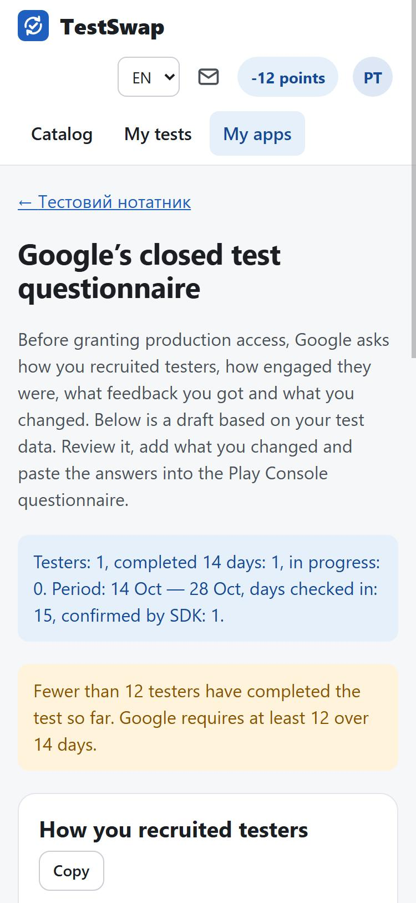

## 8. After going to production

In the **“Showcase”** panel press **“Published on Google Play”**. The site opens the app’s Google Play page and,
if it exists, shows the app on the “Launched” page. While Google Play answers “not found”, the mark cannot be
set: wait an hour after the release and try again. The page is then rechecked daily.

Questions: support@yednamo.com or the [Telegram group](https://t.me/testswap_yednamo).
