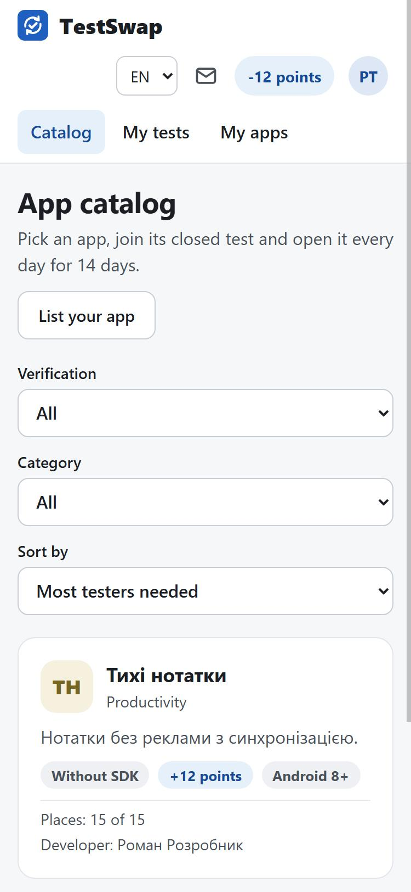
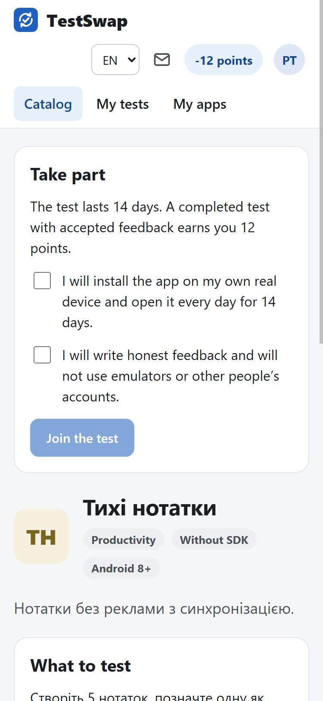
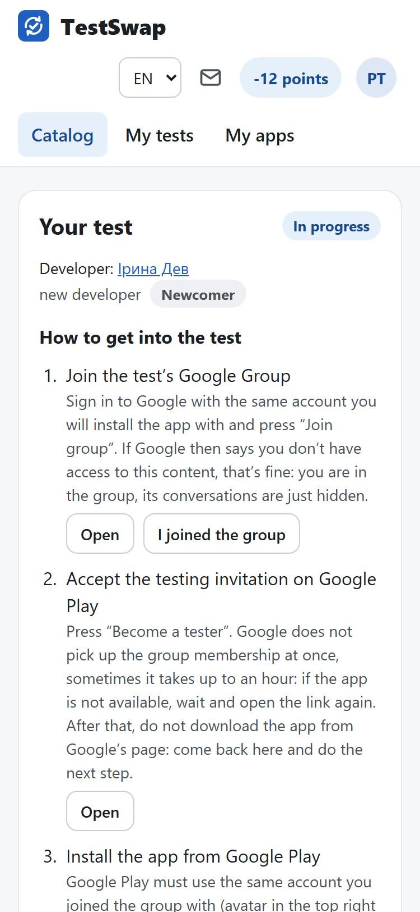
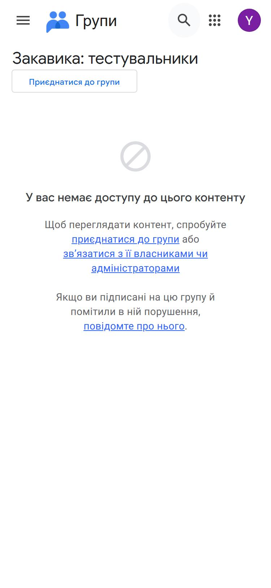
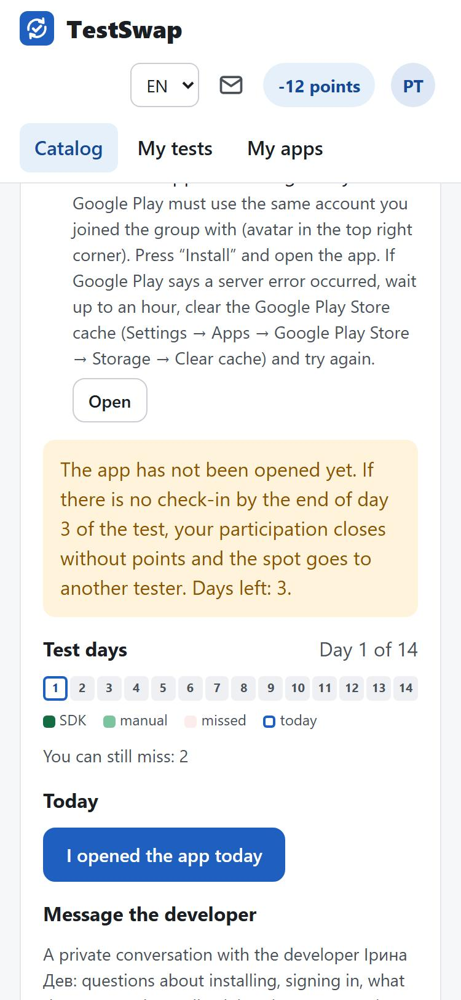
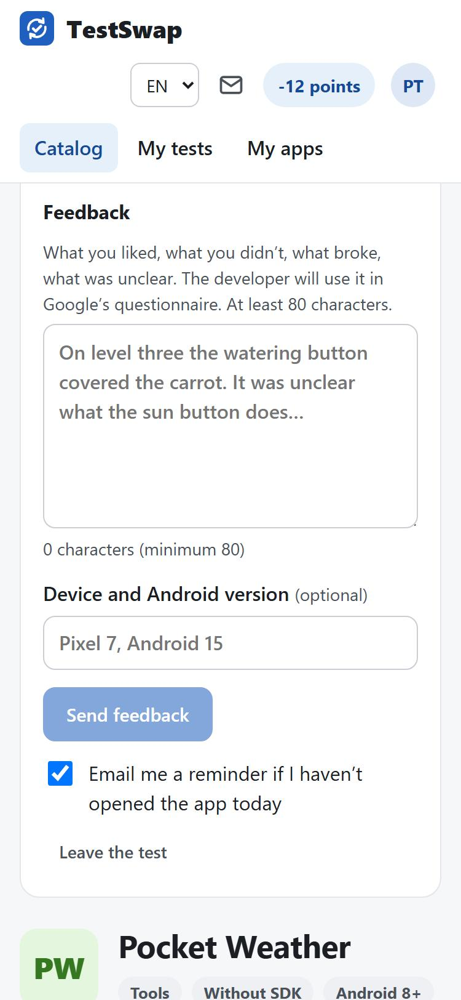
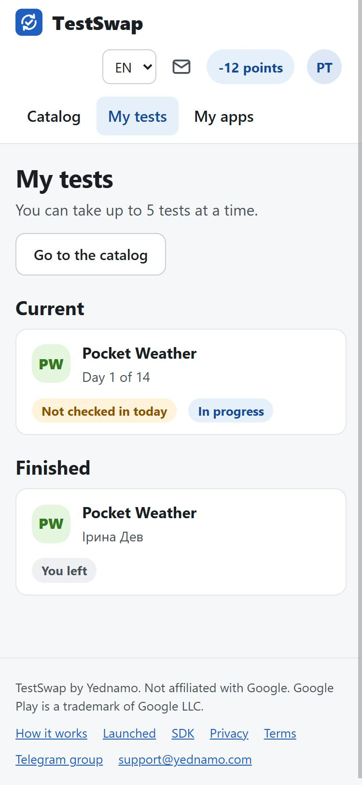
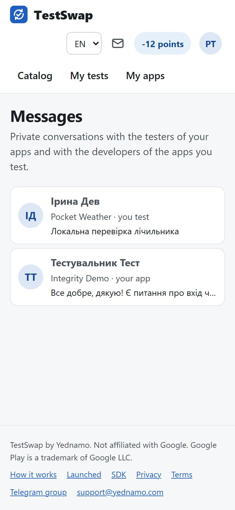

# Step-by-step guide for testers

> This guide is also on the site, with a table of contents and the same screenshots:
> https://testswap.yednamo.com/en/guide/tester. The text lives in the testswap-web repository
> (`web/src/guides/en/tester.md`); this is a copy.

How to find an app, join the testers group, install the app and get through 14 days. Short reference without
screenshots: [For testers](tester.md), [Rules and points](rules.md).

Do everything from the phone you will install the app on: links then open straight in Google Play.

## 1. Sign in

Open https://testswap.yednamo.com/en and press **“Sign in”**. Sign-in is via Google (Yednamo ID). Use the Google
account that is set up in Google Play on your phone: that is the account Google must see in the testers group.

## 2. Pick an app in the catalog

The **“Catalog”** tab. A card shows the category, the verification mode (“With SDK” or “Without SDK”), how many
points the test gives, the minimum Android version and how many places are left. The filters at the top help
you choose.

## 3. Press “Join the test”

On the app page read **“What to test”**, tick the two boxes (real device, honest feedback) and press **“Join the
test”**. The site remembers your time zone: test days are counted in it.

You can run up to 5 tests at a time.

## 4. Join the Google testers group

After joining, the test page shows the **“How to get into the test”** block with steps.

**Step 1. Join the test’s Google Group.** Press **“Open”**: the group page on groups.google.com opens. If Google
asks you to sign in, use **the same account as in Google Play on the phone**. Press **“Join group”**; if a form
with mailing settings appears, just confirm. After joining, Google often says “You don’t have permission to
access this content”. That is fine: you are in the group, the conversations are just hidden. Go back to the
test page and press **“I joined the group”**: the developer sees that you are at this step.

If the app uses an **email list** instead of a group, there is no step 1: the developer adds your email in Play
Console, and the test starts when they confirm access (you get an email). If there is no access for 7 days,
the participation closes without a penalty.

**Step 2. Accept the testing invitation on Google Play.** Press **“Open”**: the Google Play “Become a tester”
page opens. Press that button. Google picks up the group membership with a delay, sometimes up to an hour: if
the page says the app is unavailable or you have no access, wait and open the link again. **Do not download the
app from this page**: go back to the site and do step 3.

## 5. Install the app via your personal link

**Step 3. Install the app from Google Play.** Press **“Open”** on the test page: this is your personal link with
a tag by which an app with the SDK recognizes that you installed it. Open it in Chrome on the phone, not inside
Telegram or another messenger. Google Play must use the same account that joined the group (avatar in the top
right corner). Press **“Install”** and open the app.

If Google Play says a server error occurred, wait up to an hour or clear the Google Play Store cache (Settings →
Apps → Google Play Store → Storage → Clear cache) and try again.

If the app was already on the phone or you installed it another way, press **“I installed the app, link it”**
on the test page, on that same phone: the app opens and receives your tag.

## 6. Open the app every day for 14 days

- **Without SDK**: open the app every day and press **“I opened the app today”** on the test page. The “Test
  days” strip shows checked, missed and today’s day.
- **With SDK**: the day is checked in automatically when you open the app (a real phone with Google Play is
  needed, emulators fail the check). There is no manual check-in button for such tests.

If the test started at 18:00 or later in your time zone, the first day is the next one. You can miss at most 2
days. If the app has not been opened by the end of day 3, the participation closes on its own and the spot goes
to someone else (a warning email comes on day 2). In the evening, if the day is not checked in yet, the site
reminds you by email.

## 7. Write feedback

From day 1 the test page has the **“Feedback”** form (at least 80 characters): what you liked, what you did not,
what broke, what was unclear. The developer uses it in Google’s questionnaire. Above the form is a private chat
with the developer for questions about installing or signing in (Ctrl+Enter sends). The chat does not replace
the feedback.

The developer accepts the feedback or rejects it with an explanation; rejected feedback can be rewritten once.
Without a decision within 3 days it is accepted automatically.

## 8. My tests and messages

The **“My tests”** tab shows running tests (day, whether today is checked in) and finished ones. The envelope in
the header opens **“Messages”**, conversations with developers; the number on the envelope is unread messages.

## 9. After 14 days

The test counts if 14 days have passed, at most 2 were missed and there is feedback (in SDK mode, also at least
one confirmed install). You get **+10 points**, and **+2** for accepted feedback. Points are needed to list your
own app.

**Do not leave the Google group and do not opt out of the test on Google Play** until the developer closes the
test: Google counts only those who stay in the test. We will email you when you can leave. You can uninstall the
app in the meantime.

You can leave a test at any time with the button on the test page, but no points are awarded. You can return to
the same app once.

Questions: support@yednamo.com or the [Telegram group](https://t.me/testswap_yednamo).
