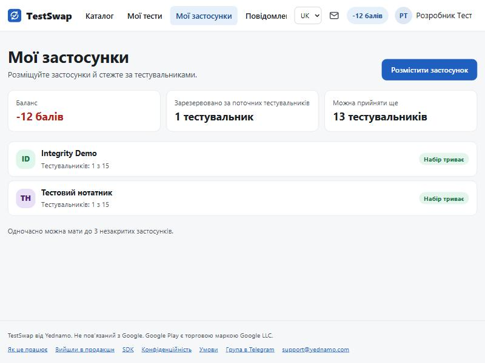
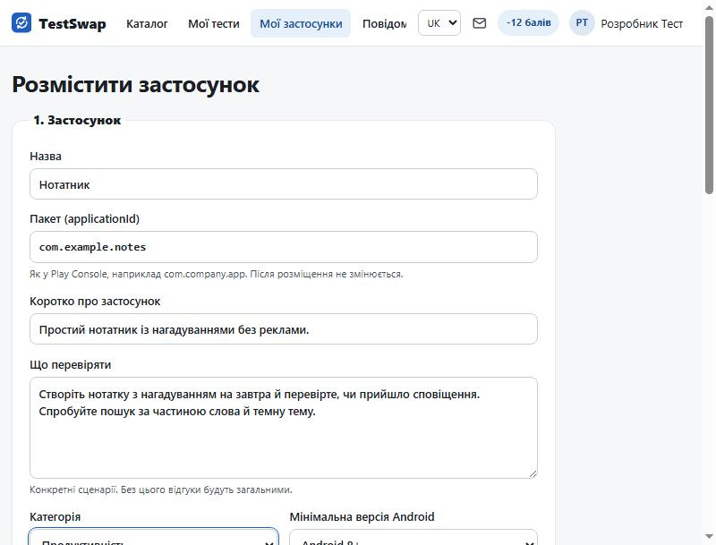
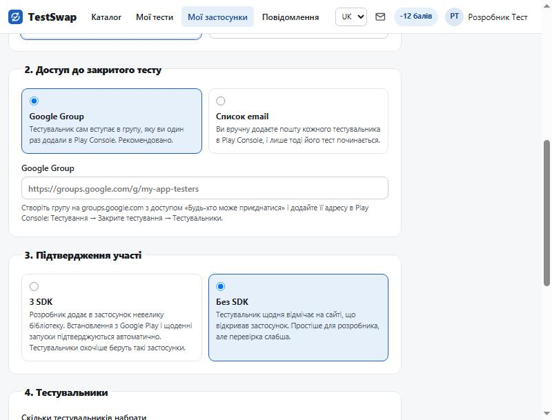
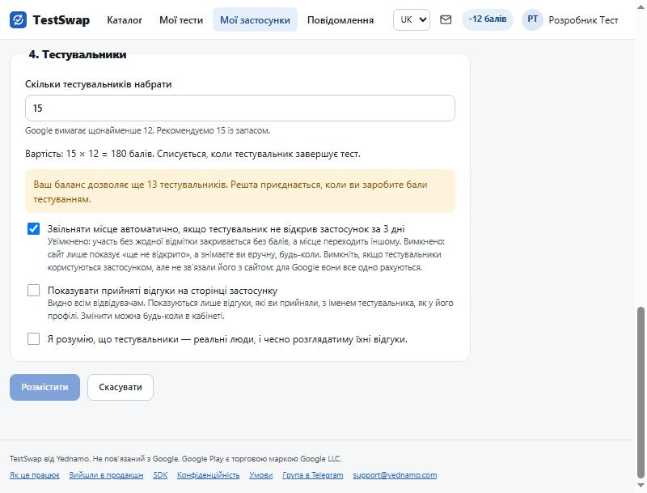
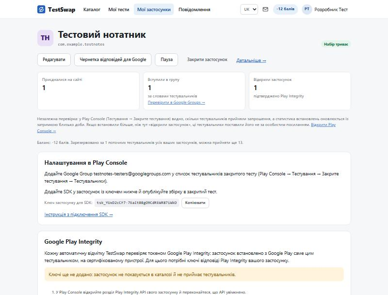
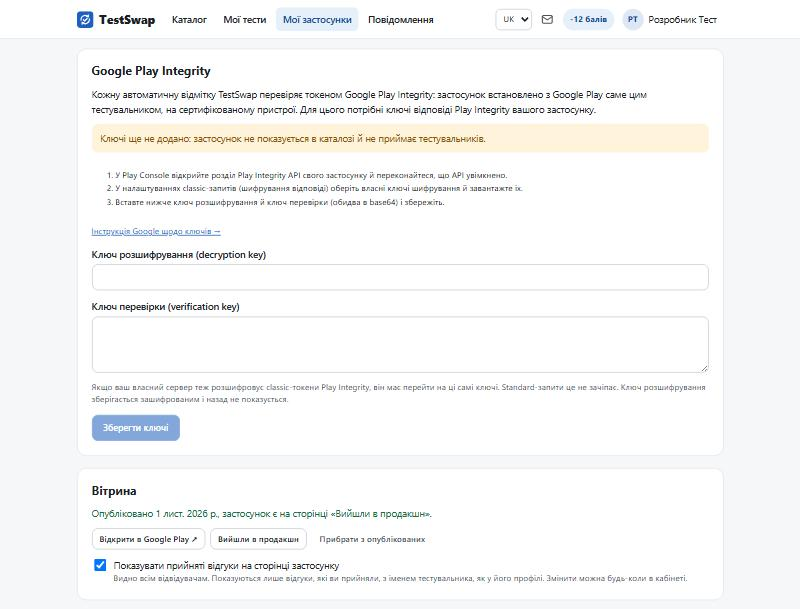
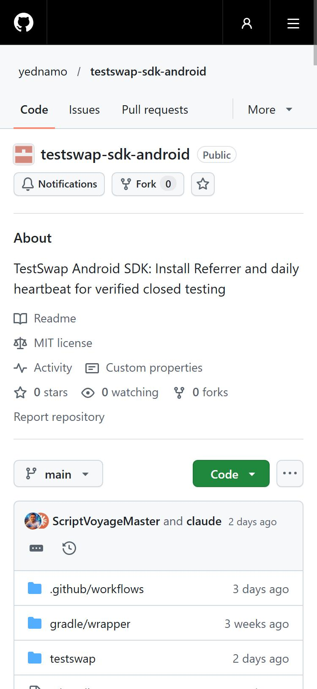
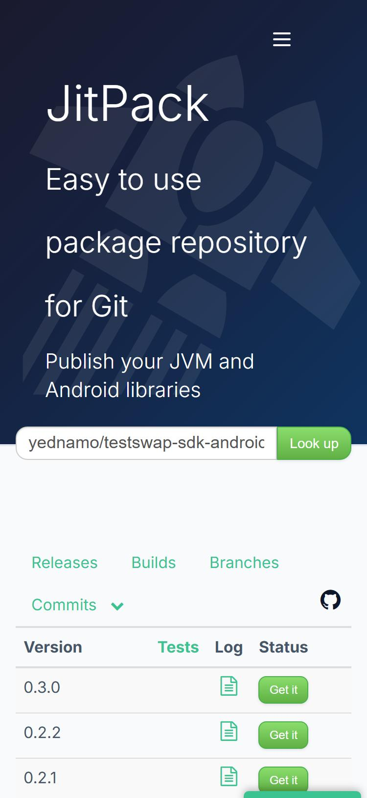
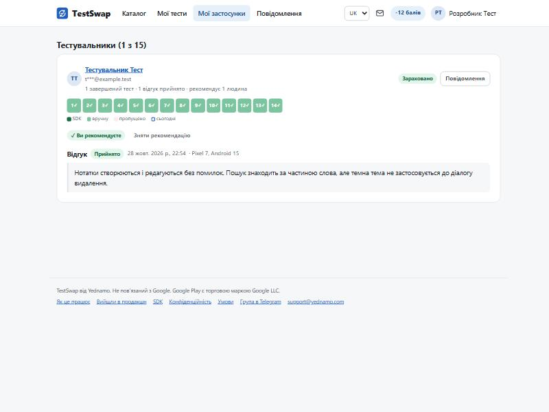
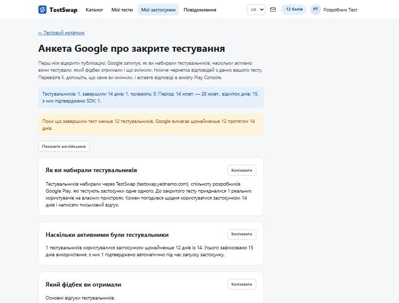

# Покрокова інструкція для розробника

> Ця інструкція є і на сайті, зі змістом і тими самими скріншотами: https://testswap.yednamo.com/guide/dev.
> Джерело тексту — репозиторій testswap-web (`web/src/guides/uk/dev.md`); тут копія.

Як розмістити застосунок у TestSwap, звідки взяти SDK і як його підключити. Коротка довідка без скріншотів:
[Розробнику](developer.md), [SDK](sdk.md), [Правила й бали](rules.md).

## 1. Увійдіть

Відкрийте https://testswap.yednamo.com і натисніть **«Увійти»** у правому верхньому куті. Вхід через Google
(Yednamo ID): оберіть акаунт, і ви повернетеся на сайт. Один акаунт діє для всіх сервісів Yednamo.

## 2. Підготуйте закритий тест у Play Console

Це робиться на боці Google, до або після розміщення в TestSwap.

Назви кнопок і пунктів меню нижче взято з українського інтерфейсу Play Console і довідки Google; в дужках англійські
назви з англійського інтерфейсу.

1. У [Play Console](https://play.google.com/console) відкрийте застосунок → **Тестування й випуск → Тестування →
   Закрите тестування** (Testing → Closed testing). Довідка Google називає такий канал тестування англійським
   словом track, а в консолі він показаний як «версія» закритого тестування. Якщо каналу ще немає, створіть його.
2. Створіть Google Group для тестувальників: https://groups.google.com → **«Створити групу»** (Create group).
   У налаштуванні **«Хто може приєднуватися до групи»** (Who can join the group) виберіть **«Приєднатися може
   будь-хто»** (Anyone on the web can join); у «Хто може переглядати обговорення» обговорення можна приховати.
   Запам'ятайте адресу групи виду `назва@googlegroups.com`.
3. У Play Console на сторінці закритого тестування натисніть **«Керувати версією»** (Manage track) → вкладка
   **«Тестувальники»** (Testers). У розділі «Тестувальники» виберіть **«Google Групи»** (Google Groups), введіть
   адресу групи й натисніть **«Зберегти зміни»** (Save changes). Посилання для доступу до випуску звідти вам не
   потрібне: TestSwap будує його сам із назви пакета.
4. Завантажте збірку й **створіть випуск** (Create release) у каналі закритого тестування. Дочекайтеся перевірки
   Google (зазвичай до кількох днів).
5. Якщо в застосунку є вхід через Google, додайте в Google Cloud SHA-1 **ключа підпису додатка** (app signing key),
   а не лише ключа завантаження: Play Console → **Захищено за допомогою Google Play** → **Розповсюдження в Google
   Play** → **«Перейти до підписування додатків у Google Play»** (Play App Signing) → розділ «Ключ підпису додатка» →
   цифровий відбиток SHA-1. Інакше в тестувальників вхід не спрацює. Докладніше в
   [Розробнику](developer.md#1-підготуйте-закритий-тест-у-play-console).

## 3. Розмістіть застосунок у TestSwap

Відкрийте **«Мої застосунки»** у верхньому меню й натисніть **«Розмістити застосунок»**.



Заповніть форму.



- **Назва** — як у Google Play.
- **Пакет (applicationId)** — точно як у Play Console, наприклад `com.company.app`. Після розміщення його не змінити:
  саме за ним будуються посилання для тестувальників.
- **Коротко про застосунок** — один-два речення для картки в каталозі.
- **Що перевіряти** — конкретні сценарії («створіть нотатку з нагадуванням і перевірте сповіщення»). Без цього
  відгуки будуть загальними.
- **Категорія** і **мінімальна версія Android** — як у Play Console. Для режиму з SDK потрібен Android 8+.



- **Доступ до закритого тесту**: оберіть **Google Group** і вставте адресу або посилання групи з кроку 2. Варіант
  «Список email» означає, що пошту кожного тестувальника ви додаєте в Play Console вручну й лише тоді його тест
  починається.
- **Підтвердження участі**: **З SDK** (застосунок сам підтверджує встановлення й дні через Google Play Integrity,
  див. розділ 5) або **Без SDK** (тестувальник щодня відмічає день на сайті). Режим можна змінити, лише поки в
  тесті ще нікого немає.



- **Скільки тестувальників набрати**: Google вимагає 12, радимо 15 із запасом. Кожен коштує 12 балів, які
  списуються, лише коли тестувальник завершує тест. Перший застосунок можна розмістити з нульовим балансом:
  борг до −180 балів дозволений, а відпрацьовується тестуванням чужих застосунків.
- **Звільняти місце автоматично** — тестувальник, що за 3 дні так і не відкрив застосунок, знімається сам.
- Поставте галочку про чесний розгляд відгуків і натисніть **«Розмістити»**.

## 4. Кабінет застосунку

Після розміщення відкривається кабінет. Угорі три числа: приєдналися на сайті, вступили в групу, відкрили
застосунок. Нижче — панель **«Налаштування в Play Console»** з адресою групи, яку треба додати в список
тестувальників, і **ключем застосунку для SDK** (`tsk_…`).



Для режиму з SDK одразу під ним панель **«Google Play Integrity»**. Поки ключі не додано, застосунок не
показується в каталозі.



Де взяти ключі:

1. Play Console → ваш застосунок → у меню ліворуч **«Захищено за допомогою Google Play»** → розділ
   **«Play Integrity API»** → **«Керувати»** (Manage). Якщо API ще не ввімкнено, там буде кнопка **«Почати»** і
   пропозиція **зв'язати проєкт Google Cloud**: зробіть це.
2. Прокрутіть до розділу **«Класичні запити»** (Classic requests). Параметр **«Шифрування відповідей»** (Response
   encryption) спочатку має статус «Під керуванням Google». Натисніть **«Змінити»** (Change) і виберіть
   **«Завантажити ключі шифрування моїх відповідей і керувати ними самостійно»** (Manage and download my response
   encryption keys). Файл із ключами завантажиться сам; пізніше його можна взяти кнопкою **«Завантажити ключі»**
   (Download keys).
3. У завантаженому файлі два рядки в base64: **ключ розшифрування** (decryption key) і **ключ перевірки**
   (verification key). Вставте їх у відповідні поля в TestSwap і натисніть **«Зберегти ключі»**.

Ключ розшифрування зберігається зашифрованим і назад не показується. Докладніше: [SDK](sdk.md#1-ключі-play-integrity)
і [документація Google](https://developer.android.com/google/play/integrity/classic).

## 5. SDK: де взяти й як підключити

SDK потрібен лише для режиму **«З SDK»**. Це невелика бібліотека з відкритим кодом (MIT).

- Код і README: https://github.com/yednamo/testswap-sdk-android
- Готові збірки роздає JitPack: https://jitpack.io/#yednamo/testswap-sdk-android (список версій, кнопка «Get it»
  показує рядки для Gradle).





### Спосіб 1 (рекомендовано): залежність Gradle

`settings.gradle.kts` проєкту — додайте репозиторій JitPack:

```kotlin
dependencyResolutionManagement {
    repositories {
        google()
        mavenCentral()
        maven { url = uri("https://jitpack.io") }
    }
}
```

`app/build.gradle.kts` — залежність (актуальна версія на JitPack, зараз 0.3.0):

```kotlin
dependencies {
    implementation("com.github.yednamo:testswap-sdk-android:0.3.0")
}
```

### Спосіб 2: завантажити AAR вручну

Якщо ваш проєкт не може тягнути залежності з JitPack, завантажте файл бібліотеки:

```
https://jitpack.io/com/github/yednamo/testswap-sdk-android/0.3.0/testswap-sdk-android-0.3.0.aar
```

Покладіть його в `app/libs/` і підключіть у `app/build.gradle.kts`:

```kotlin
dependencies {
    implementation(files("libs/testswap-sdk-android-0.3.0.aar"))
    implementation("com.android.installreferrer:installreferrer:2.2")
    implementation("com.google.android.play:integrity:1.6.0")
}
```

Дві додаткові залежності потрібні, бо AAR не тягне їх за собою (через JitPack вони під'єднуються автоматично).
Версії — ті самі, що в `testswap/build.gradle.kts` репозиторію SDK.

### Виклик у коді

Створіть клас `Application` (або додайте в наявний) і викличте `TestSwap.init` з ключем застосунку з кабінету:

```kotlin
import android.app.Application
import com.yednamo.testswap.TestSwap

class App : Application() {
    override fun onCreate() {
        super.onCreate()
        TestSwap.init(this, "tsk_...") // ключ із панелі «Налаштування в Play Console»
    }
}
```

Java:

```java
public class App extends Application {
    @Override public void onCreate() {
        super.onCreate();
        TestSwap.init(this, "tsk_...");
    }
}
```

У `AndroidManifest.xml` вкажіть цей клас, якщо його ще не було:

```xml
<application android:name=".App" ...>
```

Більше нічого додавати не треба: дозвіл `INTERNET` і `LinkActivity` для посилання «Я встановив застосунок,
зв'язати» бібліотека оголошує сама. Мінімальна версія Android: 8.0 (API 26).

Зберіть реліз із SDK, завантажте його в закрите тестування й опублікуйте. Для діагностики
`TestSwap.setDebug(true)` пише докладні повідомлення в Logcat (тег `TestSwap`).

### Перевірка

1. У кабінеті має бути «Ключі додано».
2. Приєднайтеся до свого тесту з іншого Google-акаунта (на іншому телефоні), встановіть застосунок за особистим
   посиланням зі сторінки тесту й відкрийте його.
3. У кабінеті біля тестувальника з'явиться «Застосунок відкрито …, підтверджено Play Integrity», а в панелі
   Integrity — час останньої успішної перевірки. Якщо перевірка не пройшла, там же видно причину.

У першому релізі після виходу в продакшн приберіть залежність і виклик `TestSwap.init`.

## 6. Під час тесту

Нижче в кабінеті список тестувальників: крок (приєднався, у групі, відкрив застосунок), дні 1–14, джерело
відміток, відгук.



- **Відгук**: натисніть «Прийняти» або «Відхилити» з поясненням. Без рішення за 3 дні відгук приймається сам.
- **Повідомлення**: кнопка біля тестувальника відкриває приватний чат. Усі розмови зібрано на сторінці
  «Повідомлення» (конверт угорі).
- **Зняти з тесту**: якщо тестувальник не встановив застосунок. Того, хто вже відмічався, можна зняти лише до
  3-го дня.
- **Пауза** зупиняє набір, поточні тести тривають. **Закрити застосунок** — лише після подачі заявки в Play
  Console: доти тестувальники лишаються в групі, бо Google рахує лише тих, хто в тесті останні 14 днів.

## 7. Анкета Google

Коли 12 тестувальників пройшли 14 днів, Play Console пропонує анкету про тестування. Кнопка **«Чернетка
відповідей для Google»** у кабінеті збирає статистику й відгуки в готові відповіді (українською або англійською):
скопіюйте, перевірте й допишіть, що ви змінили після відгуків.



## 8. Після виходу в продакшн

У панелі **«Вітрина»** натисніть **«Опубліковано в Google Play»**. Сайт відкриє сторінку застосунку в Google
Play і, якщо вона є, покаже застосунок на сторінці «Вийшли в продакшн». Поки Google Play відповідає «не
знайдено», позначку поставити не можна: зачекайте годину після релізу й спробуйте знову. Сторінка далі
перевіряється щодня.

Питання: support@yednamo.com або [група в Telegram](https://t.me/testswap_yednamo).
