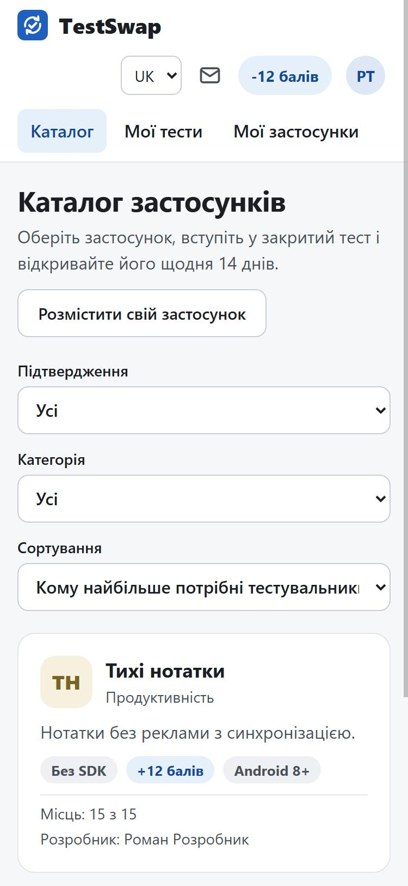
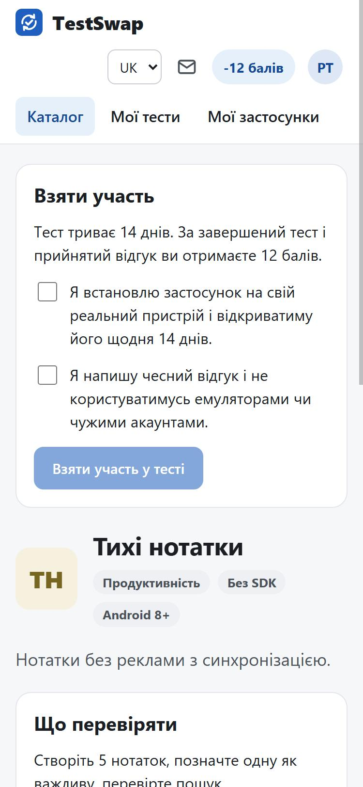
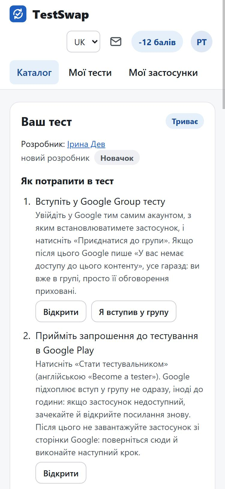
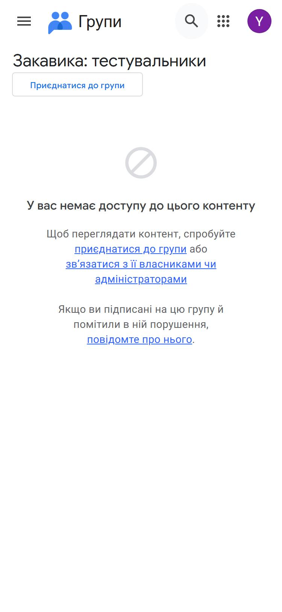
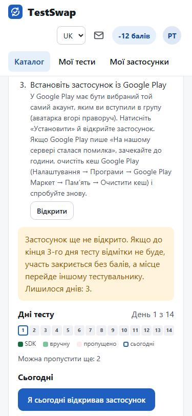
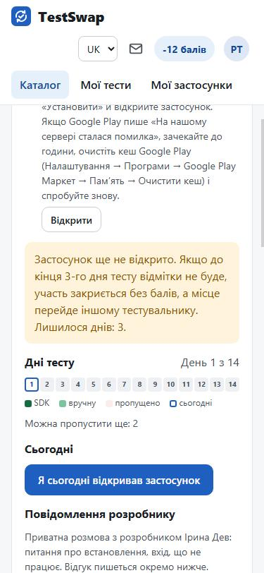
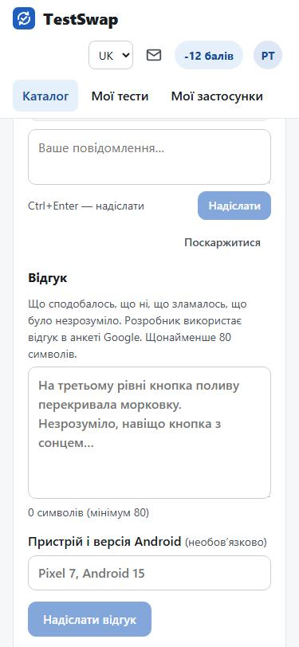
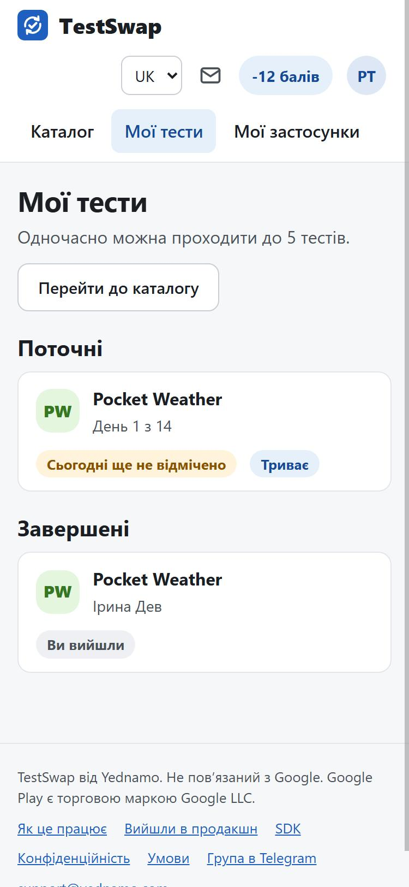
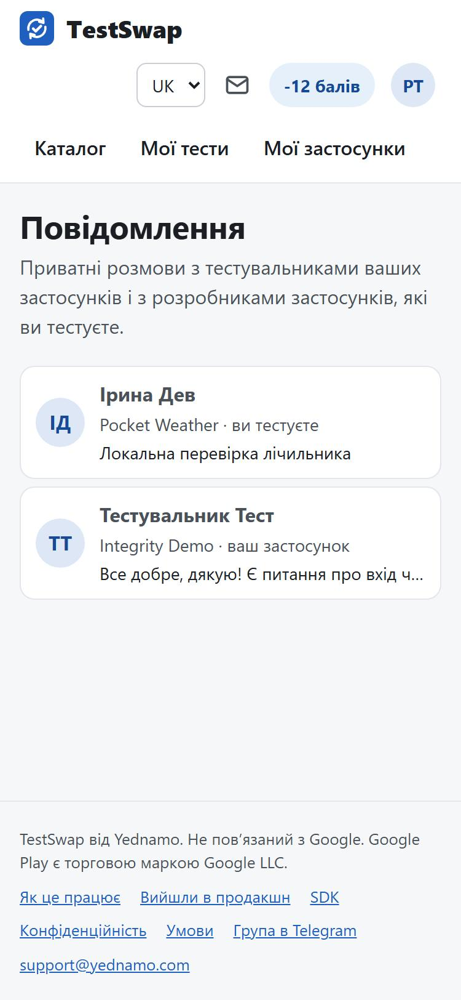

# Покрокова інструкція для тестувальника

Як знайти застосунок, вступити в групу тестувальників, встановити застосунок і пройти 14 днів. Коротка довідка
без скріншотів: [Тестувальнику](tester.md), [Правила й бали](rules.md).

Усе робиться з телефона, на який ви встановлюватимете застосунок: так посилання відкриваються одразу в Google Play.

## 1. Увійдіть

Відкрийте https://testswap.yednamo.com і натисніть **«Увійти»**. Вхід через Google (Yednamo ID). Увійдіть тим
Google-акаунтом, який стоїть у Google Play на вашому телефоні: саме його Google має бачити в групі тестувальників.

## 2. Оберіть застосунок у каталозі

Вкладка **«Каталог»**. На картці видно категорію, режим підтвердження («З SDK» або «Без SDK»), скільки балів дає
тест, мінімальну версію Android і скільки місць лишилося. Фільтри вгорі допомагають обрати.

## 3. Натисніть «Взяти участь у тесті»

На сторінці застосунку прочитайте **«Що перевіряти»**, поставте дві галочки (реальний пристрій, чесний відгук) і
натисніть **«Взяти участь у тесті»**. Сайт запам'ятає ваш часовий пояс: дні тесту рахуються за ним.

Одночасно можна проходити до 5 тестів.

## 4. Вступіть у групу тестувальників Google

Після приєднання на сторінці тесту з'являється блок **«Як потрапити в тест»** із кроками.

**Крок 1. Вступіть у Google Group тесту.** Натисніть **«Відкрити»**: відкриється сторінка групи на
groups.google.com. Якщо Google попросить увійти, увійдіть **тим самим акаунтом, що й у Google Play на телефоні**.
Натисніть **«Приєднатися до групи»** (англійською «Join group»); якщо з'явиться форма з налаштуваннями розсилки,
просто підтвердьте. Після вступу Google нерідко пише «У вас немає доступу до цього контенту» — це нормально: ви
вже в групі, просто обговорення приховані. Поверніться на сторінку тесту й натисніть **«Я вступив у групу»**:
розробник побачить, що ви на цьому кроці.

Якщо в застосунку замість групи **список email**, кроку 1 немає: розробник сам додасть вашу пошту в Play Console,
і тест почнеться, коли він підтвердить доступ (ви отримаєте лист). Якщо доступу немає 7 днів, участь закриється
без штрафу.

**Крок 2. Прийміть запрошення до тестування в Google Play.** Натисніть **«Відкрити»**: відкриється сторінка Google
Play «Стати тестувальником» (Become a tester). Натисніть цю кнопку. Google підхоплює вступ у групу не одразу,
інколи до години: якщо сторінка пише, що застосунок недоступний або ви не маєте доступу, зачекайте й відкрийте
посилання знову. **Не завантажуйте застосунок з цієї сторінки**: поверніться на сайт і зробіть крок 3.

## 5. Встановіть застосунок за особистим посиланням

**Крок 3. Встановіть застосунок із Google Play.** Натисніть **«Відкрити»** на сторінці тесту: це ваше особисте
посилання з міткою, за якою застосунок із SDK впізнає, що встановили саме ви. Відкривайте його в Chrome на
телефоні, не всередині Telegram чи іншого месенджера. У Google Play має бути вибраний той самий акаунт, що
вступив у групу (аватарка вгорі праворуч). Натисніть **«Установити»** й відкрийте застосунок.

Якщо Google Play пише «На нашому сервері сталася помилка», зачекайте до години або очистіть кеш Google Play
(Налаштування → Програми → Google Play Маркет → Пам'ять → Очистити кеш) і спробуйте знову.

Якщо застосунок уже стояв на телефоні або ви встановили його інакше, натисніть на сторінці тесту **«Я встановив
застосунок, зв'язати»** на тому самому телефоні: застосунок відкриється й отримає вашу мітку.

## 6. Відкривайте застосунок щодня 14 днів

- **Без SDK**: щодня відкривайте застосунок і натискайте на сторінці тесту **«Я сьогодні відкривав застосунок»**.
  Смужка «Дні тесту» показує відмічені, пропущені й сьогоднішній день.
- **З SDK**: день відмічається сам, коли ви відкриваєте застосунок (потрібен справжній телефон із Google Play,
  емулятори не проходять перевірку). Кнопки ручної відмітки для таких тестів немає.

Якщо тест почався о 18:00 або пізніше за вашим часом, першим днем буде наступний. Пропустити можна не більше 2
днів. Якщо застосунок не відкрито до кінця 3-го дня, участь закривається сама, а місце переходить іншому (на 2-й
день прийде лист-попередження). Увечері, якщо день ще не відмічено, сайт нагадує листом.

## 7. Напишіть відгук

З 1-го дня на сторінці тесту доступна форма **«Відгук»** (щонайменше 80 символів): що сподобалось, що ні, що
зламалось, що незрозуміло. Розробник використає його в анкеті для Google. Над формою — приватний чат з
розробником для питань про встановлення чи вхід (Ctrl+Enter надсилає). Чат не замінює відгук.

Розробник приймає відгук або відхиляє з поясненням; відхилений можна переписати один раз. Без рішення за 3 дні
відгук приймається автоматично.

## 8. Мої тести й повідомлення

Вкладка **«Мої тести»** показує поточні тести (день, чи відмічено сьогодні) і завершені. Конверт у шапці
відкриває **«Повідомлення»** — розмови з розробниками; число на конверті — непрочитані.

## 9. Після 14 днів

Тест зараховується, якщо минуло 14 днів, пропущено не більше 2 і є відгук (у режимі SDK — ще й хоч одне
підтвердження встановлення). Ви отримуєте **+10 балів**, за прийнятий відгук **+2**. Бали потрібні, щоб розмістити
власний застосунок.

**Не виходьте з групи Google і не відмовляйтеся від тесту в Google Play**, поки розробник не закриє тест: Google
зараховує лише тих, хто лишається в тесті. Ми надішлемо лист, коли можна буде вийти. Застосунок при цьому можна
видалити.

Вийти з тесту можна будь-коли кнопкою на сторінці тесту, але бали не нарахуються. Повернутися до того самого
застосунку можна один раз.

Питання: support@yednamo.com або [група в Telegram](https://t.me/testswap_yednamo).
